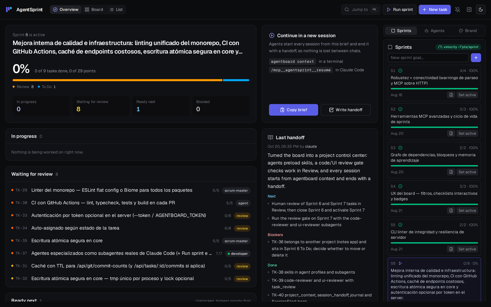
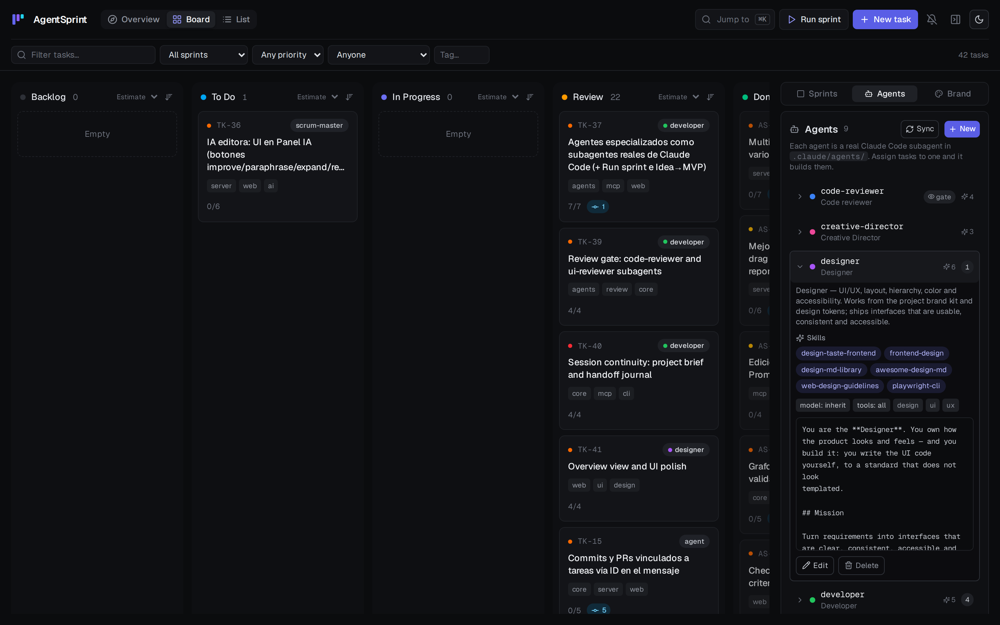
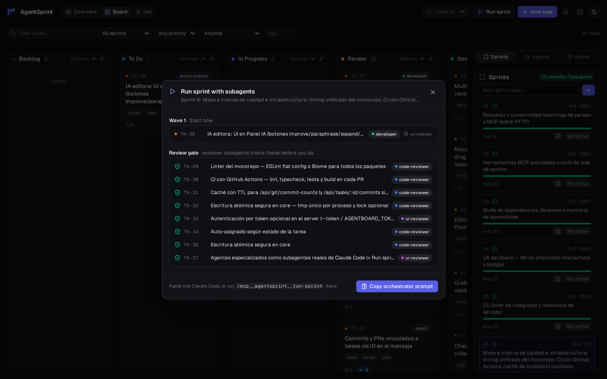
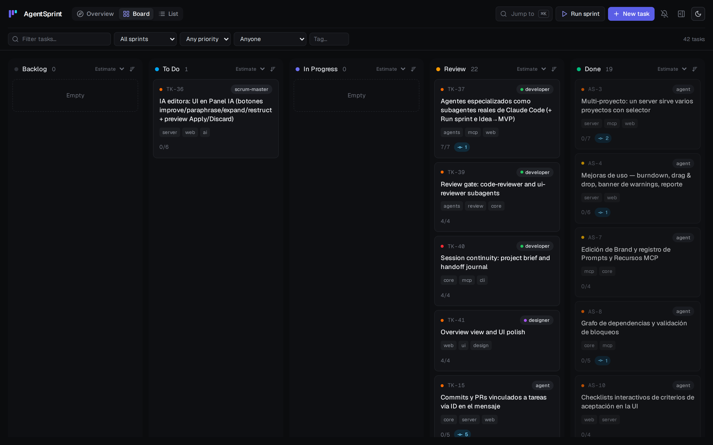
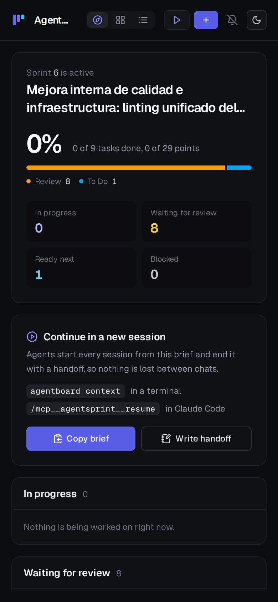
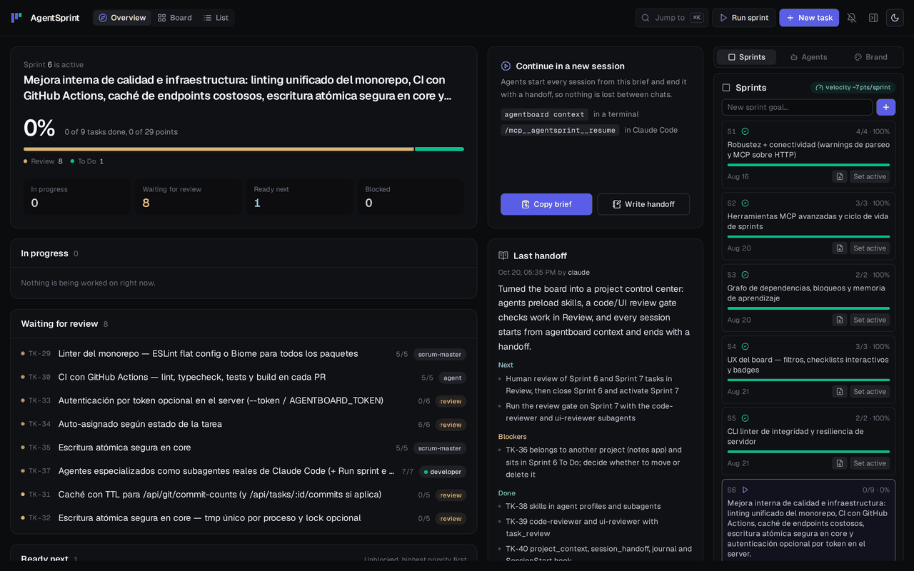

<p align="center">
  
</p>

<h1 align="center">AgentSprint</h1>

<p align="center">
  <b>The project control center for coding with AI agents.</b><br>
  A git-native sprint board that remembers where the project is, so every new agent session picks up exactly where the last one stopped.
</p>

<p align="center">
  <a href="https://github.com/jmrojas06/AgentSprint/actions/workflows/ci.yml"></a>
  <a href="https://www.npmjs.com/package/@jmrojas06/agentsprint-cli"></a>
  <a href="https://jmrojas06.github.io/AgentSprint/"></a>
  <a href="LICENSE"></a>
</p>

<p align="center">
  <picture>
    <source media="(prefers-color-scheme: light)" srcset="docs/public/screenshots/overview-light.png">
    
  </picture>
</p>

## Why

AI agents are great at doing work and terrible at remembering it. When a chat ends, the plan, the half-done task and the reason behind a decision end with it. The next session starts cold and asks you to explain everything again.

AgentSprint keeps that memory in your repository, next to the code:

- **The board is the memory.** Tasks, sprints, acceptance criteria and notes are Markdown files in `.agentboard/`. Git history is board history.
- **Every session starts from a brief.** `agentboard context` (or the `project_context` MCP tool) tells any agent where the project is: active sprint, what is in progress, what is waiting for review, what comes next, what is blocked, the last handoff and the lessons learned.
- **Every session ends with a handoff.** `session_handoff` appends what was done, what is next and what is in the way to `.agentboard/journal.md`. The next session reads it first.
- **Specialists when you want them.** Developer, designer, tester, fixer and docs agents become real Claude Code subagents. They use the skills you already have, on demand, and you can edit them or add your own.
- **A review gate checks it before you do.** A read-only `code-reviewer` and `ui-reviewer` judge every task in Review and send it back with findings when it is not right. You only look at work that already passed.

No accounts, no cloud, no server to babysit. Your board is a folder in Git.

## Quick start

Requires Node.js 20 or newer.

```bash
npx @jmrojas06/agentsprint-cli init      # board, getting-started examples and 10 editable agents
npx @jmrojas06/agentsprint-cli connect   # MCP server + SessionStart hook for Claude Code
npx @jmrojas06/agentsprint-cli serve     # the board at http://127.0.0.1:4310
```

Then open Claude Code in the folder and approve the `agentsprint` MCP server. From now on every session starts with the project brief injected automatically. On a new board Claude first asks what you are building and turns it into tasks. After that:

```text
/mcp__agentsprint__resume       # continue in this session (light, cheapest)
/mcp__agentsprint__run-sprint   # specialist subagents + review gate (more tokens)
```

The [quick start](https://jmrojas06.github.io/AgentSprint/quick-start) walks through it step by step.

To plan a new product, open the board and choose **Start from an idea** (in the command palette, or on the Overview when nothing is pending). Describe the idea, copy the prompt and paste it into Claude Code as a message. Claude Code splits slash-command arguments on spaces, so a multi-word idea typed after `/mcp__agentsprint__idea-to-mvp` reaches the prompt cut off.

Prefer the short `agentboard` binary? `npm install -g @jmrojas06/agentsprint-cli`.

## How a session works

```text
start   agentboard context / project_context  →  where are we, what is next
work    task_claim → task_spec → code → task_checklist / task_note → Review
gate    code-reviewer or ui-reviewer → task_review: approve, or changes with findings
end     session_handoff  →  .agentboard/journal.md (done, next, blockers)
```

`agentboard connect` writes a `SessionStart` hook into `.claude/settings.local.json`, so the brief arrives in every new, resumed, cleared or compacted Claude Code session without anyone asking for it. Agents that are not Claude Code read the same instructions from `AGENTS.md` and the MCP server instructions.

## Specialists and their skills

`agentboard init` writes ten agent profiles to `.agentboard/agents/` and mirrors them to `.claude/agents/` as Claude Code subagents. They are plain prompts: edit them, delete the ones you do not need or add your own from the **Agents** tab.

None preloads a skill. Each prompt names the [skills](https://code.claude.com/docs/en/skills) that help at each step, and the subagent invokes the ones you have installed when it needs them, so only the skills it uses cost tokens. Without any skill installed the rules in each prompt still hold.

| Agent | Job | Skills it uses when installed |
| --- | --- | --- |
| `developer` | Smallest correct change, full suite green | karpathy-guidelines, test-driven-development, systematic-debugging, verification-before-completion |
| `designer` | Builds UI that does not look templated | design-taste-frontend, awesome-design-md, frontend-design, web-design-guidelines, playwright-cli |
| `tester` | Tests from acceptance criteria, edges first | test-driven-development, tdd, playwright-cli, verification-before-completion |
| `fixer` | Reproduce, root cause, failing test, small patch | systematic-debugging, test-driven-development, verification-before-completion |
| `docs` | Docs verified against the code that ships | grill-with-docs, verification-before-completion |
| `creative-director` | Vision, tone and the quality bar | design-taste-frontend, brainstorming |
| `ideator` | Divergent options, ranked shortlist | brainstorming |
| `code-reviewer` | Review gate for code, read-only | requesting-code-review, karpathy-guidelines, verification-before-completion |
| `ui-reviewer` | Review gate for UI, read-only | web-design-guidelines, design-taste-frontend, playwright-cli |
| `review-assistant` | Briefs you on what waits in Review, read-only | — |

[Where each skill comes from](https://jmrojas06.github.io/AgentSprint/agents#where-the-suggested-skills-come-from) and how to install it. A profile can still force a skill into every launch with `skills:`, but Claude Code then injects its full text each time; keep that for the rare skill an agent must always have.

<p align="center">
  
</p>

## The review gate

Work moves to Review, then a reviewer subagent checks it before a human does. `sprint_dispatch` names the gate for every task: `ui-reviewer` for anything tagged design, ui, ux or frontend, `code-reviewer` for the rest. Reviewers cannot edit files (`disallowedTools: Edit, Write, NotebookEdit`); they record a verdict with `task_review`:

- **approve** keeps the task in Review, with an "Approved" badge, for you to move to Done.
- **changes** moves it back to In Progress with findings (file:line, failing scenario, fix) and the orchestrator re-launches the implementer.

Then approve from the chat: the `human-review` prompt reads `review_queue`, asks you a few batched multiple-choice questions (with a `review-assistant` brief when something needs a look) and records your answers with `review_decide`.

<p align="center">
  
</p>

## The board

<table>
  <tr>
    <td width="66%"></td>
    <td width="34%"></td>
  </tr>
</table>

- **Overview**: sprint progress, work in flight with its last note, review verdicts, what is ready next, blockers, the last handoff and the session journal. Write a handoff or copy the brief for a new session from here.
- **Board and List**: drag and drop, filters, sorting, checklists, dependency badges, linked commits.
- **Run sprint**: the dispatch plan as waves of parallel subagents, ready to paste into Claude Code.
- **Sprints, Agents and Brand** in a collapsible side panel; light and dark themes; `⌘K` command palette.

<p align="center">
  
</p>

## CLI

| Command | Purpose |
| --- | --- |
| `agentboard init [dir]` | Scaffold `.agentboard/`, `AGENTS.md` and the specialist agents |
| `agentboard serve [dir]` | Board UI, REST API and file watcher (default command) |
| `agentboard context [dir]` | Print the session brief: sprint, in progress, next, blockers, last handoff |
| `agentboard handoff [dir] --summary … --next … --blocker …` | Append a session handoff to `journal.md` |
| `agentboard connect [dir]` | Register the MCP server and the SessionStart hook for Claude Code |
| `agentboard agents [sync] [dir]` | List agents or regenerate `.claude/agents/` |
| `agentboard skills [dir]` | Installed skills, and the ones agents preload with `skills:` |
| `agentboard dispatch [dir]` | The parallel subagent plan for the active sprint |
| `agentboard spec <dir> <id>` | A self-contained prompt for one task |
| `agentboard lint [dir]` | Check board integrity |
| `agentboard close [dir] [id]` | Close a sprint and append a retro to `learnings.md` |
| `agentboard task new`, `import todo`, `import github`, `export md`, `brand`, `mcp` | See the [CLI reference](https://jmrojas06.github.io/AgentSprint/cli) |

## MCP

Around 40 tools over stdio (`agentboard mcp`) and Streamable HTTP (`agentboard serve --mcp`). The ones that matter most:

| Tool | Purpose |
| --- | --- |
| `project_context` | Start here: the session brief |
| `session_handoff` / `session_journal` | Leave and read handoffs |
| `task_claim` / `task_spec` / `task_checklist` / `task_note` / `task_status` | Work one task end to end |
| `task_review` | Review-gate verdict: approve or changes with findings |
| `sprint_dispatch` | Waves of parallel tasks with the subagent and reviewer for each |
| `task_create_batch` | Create a whole linked plan in one call |
| `agent_upsert` / `agent_sync` / `skill_list` | Manage specialists and their skills |

Prompts: `resume`, `idea-to-mvp`, `run-sprint`, `human-review`, `sprint-plan`, `execute-task`, `sprint-retro`. Full reference: [docs/mcp.md](https://jmrojas06.github.io/AgentSprint/mcp).

## Docker

```bash
docker run -d --name board --restart unless-stopped -p 4310:4310 \
  -v /path/to/your-project:/board \
  ghcr.io/jmrojas06/agentsprint serve /board --host 0.0.0.0 --no-open --init --mcp
```

The board is at `http://localhost:4310` and remote agents connect to `/mcp`. Add `--token <secret>` before exposing it beyond your machine.

From a checkout, `pnpm docker:up` rebuilds the image from your code and restarts the container. A container keeps running the image it was built from, so after pulling or changing code run it again. `curl localhost:4310/api/health` and the side panel footer show the build's commit, so you can tell which build you are looking at. More in [docs/installation.md](docs/installation.md#which-agentsprint-am-i-talking-to).

## Documentation

[Installation](https://jmrojas06.github.io/AgentSprint/installation) ·
[Quick start](https://jmrojas06.github.io/AgentSprint/quick-start) ·
[Task format](https://jmrojas06.github.io/AgentSprint/task-format) ·
[Agents, skills and review gate](https://jmrojas06.github.io/AgentSprint/agents) ·
[MCP](https://jmrojas06.github.io/AgentSprint/mcp) ·
[REST API](https://jmrojas06.github.io/AgentSprint/api) ·
[Architecture](https://jmrojas06.github.io/AgentSprint/architecture) ·
[Troubleshooting](https://jmrojas06.github.io/AgentSprint/troubleshooting) ·
[Changelog](CHANGELOG.md)

## Contributing

See [CONTRIBUTING.md](CONTRIBUTING.md). Before a pull request:

```bash
pnpm lint && pnpm typecheck && pnpm test && pnpm build
```

AgentSprint is built on its own board: `.agentboard/` in this repository is the real plan, and `agentboard context .` shows where it stands.

## License

[MIT](LICENSE)
